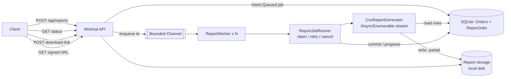

# High-Performance Reporting Engine

An ASP.NET Core (.NET 8) service that generates **large CSV reports asynchronously**: it streams rows from the
database to disk in constant memory, tracks progress, retries failures, supports cancellation, and hands out
**expiring, HMAC-signed download links**.

> All data is synthetic and generated locally. This is an original demonstration project; it contains no code,
> schemas, or data from any employer.

## Problem

Report requests that load a whole result set into memory (`ToList()` → build string → return) time out in the web
request and exhaust memory as data grows. This project shows the alternative: accept the request immediately
(`202 Accepted`), do the work in a background worker, stream rows to storage, and let the client poll and download.

## Architecture



Key decisions and trade-offs:

| Decision | Why | Trade-off |
|---|---|---|
| In-process `Channel<Guid>` + `BackgroundService` | No extra infrastructure; easy to run and test | Queue is not shared across instances. Hangfire/a broker would be the next step for multi-node deployments |
| Job state in the database | Survives restarts; unfinished jobs are re-queued on startup | Restarted jobs begin again from row 0 |
| SQLite | Zero-setup demo, runs in CI | Not a production OLTP database; the generator only needs `IQueryable<Order>`, so swapping providers is straightforward |
| `IReportStorage` with `.partial` + commit | Downloads never see half-written files | Only a local-disk implementation exists |
| Atomic claim (`UPDATE … WHERE Status='Queued'`) | Two workers can never run the same job | — |

## How streaming works

`CsvReportGenerator` runs `AsNoTracking().OrderBy(Id).AsAsyncEnumerable()` and writes each row through a
`StreamWriter` (64 KB buffer) into the output stream. Memory is bounded by the buffer plus one row, regardless of
result size. Progress is persisted every `ProgressEveryRows` rows. Values starting with `=`, `+`, `-`, `@` are
prefixed with `'` to prevent spreadsheet formula injection, and fields are RFC 4180 quoted.

## Reliability behaviour (what is and is not implemented)

- **Retries:** up to `MaxAttempts` with exponential back-off. Each retry **restarts the report from the beginning**.
- **Cancellation:** `POST /api/reports/{id}/cancel` cancels queued jobs immediately and running jobs via a
  cancellation token; partial files are deleted.
- **Shutdown/crash:** interrupted jobs are put back to `Queued` and re-run from scratch on next start.
- **Checkpoint resume: not implemented.** A safe resume needs a stable ordering key, an append-safe storage
  target and verification of the already-written prefix. Local disk plus keyset pagination could support it; this
  project deliberately does not claim it.

## Run it

Prerequisites: .NET 8 SDK (or Docker).

```bash
dotnet run --project src/ReportingEngine.Api        # Development env: Swagger at /swagger
curl -X POST "http://localhost:5000/api/dev/seed?rows=1000000"   # synthetic data (Development only)
```

Use the port printed on startup. With Docker:

```bash
cp .env.example .env     # then set a long random REPORTS_DOWNLOAD_SECRET
docker compose up --build
```

## API examples

```bash
# 1. Request a report
curl -X POST http://localhost:5000/api/reports -H "Content-Type: application/json" \
  -d '{"from":"2024-01-01","to":"2025-12-31","region":"North"}'
# 2. Poll status / progress
curl http://localhost:5000/api/reports/{id}
# 3. Cancel
curl -X POST http://localhost:5000/api/reports/{id}/cancel
# 4. Get an expiring signed link, then download it
curl -X POST http://localhost:5000/api/reports/{id}/download-link
curl -o report.csv "http://localhost:5000<url-from-previous-response>"
```

## Configuration

Environment variables use `__` as separator (e.g. `Reports__MaxAttempts=5`). **`Reports__DownloadSecret` is required**
(min 32 chars); the app refuses to start without it outside Development.

| Setting | Default | Meaning |
|---|---|---|
| `Reports:MaxAttempts` | 3 | Attempts per job |
| `Reports:RetryBaseDelayMs` | 500 | Back-off base (doubles each attempt) |
| `Reports:DownloadLinkMinutes` | 15 | Signed-link lifetime |
| `Reports:ProgressEveryRows` | 10000 | Progress persistence interval |
| `Reports:MaxConcurrentJobs` | 2 | Parallel workers |
| `Reports:QueueCapacity` | 1000 | Queue bound; full queue → `503` |

## Tests

```bash
dotnet test
```

Covers: CSV correctness, quoting and formula-injection neutralisation, region filter, a 100,000-row streaming test,
mid-stream cancellation, retry-then-succeed, fail-after-max-attempts with cleanup, cancellation of a running job,
shutdown re-queue, duplicate-claim protection, signed-link validity/expiry/tampering, and an end-to-end HTTP flow.

## Security notes

- Download links are HMAC-SHA256 signed, expire, and are compared in constant time. The secret is never in source.
- Storage keys are reduced to a file name to prevent path traversal.
- **This sample has no user authentication** — anyone who can reach the API can request reports. See the separate
  Secure Authentication & RBAC project for that concern.

## Known limitations / future improvements

- No performance benchmarks have been recorded yet; a BenchmarkDotNet or load-script run with measured
  rows/sec and peak memory should be added (job responses already report `rowsPerSecond`).
- Redis (distributed queue/locking) and S3-compatible storage are not implemented; they are the intended next steps behind the existing `IJobQueue` / `IReportStorage` seams.
- Schema is created with `EnsureCreated`; add EF Core migrations before using a real database.
- Checkpoint-based resume (see above).

## License

MIT
